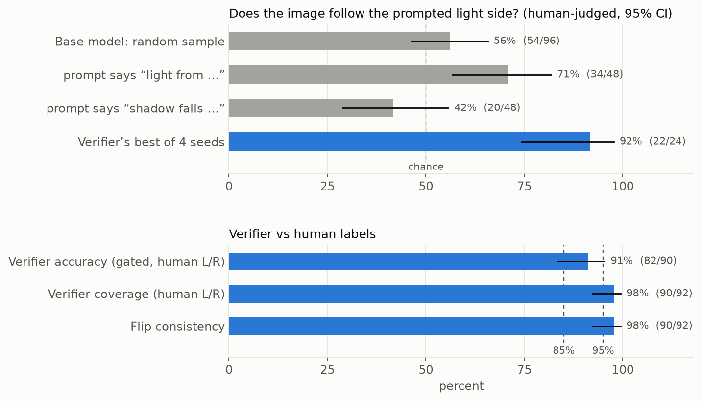
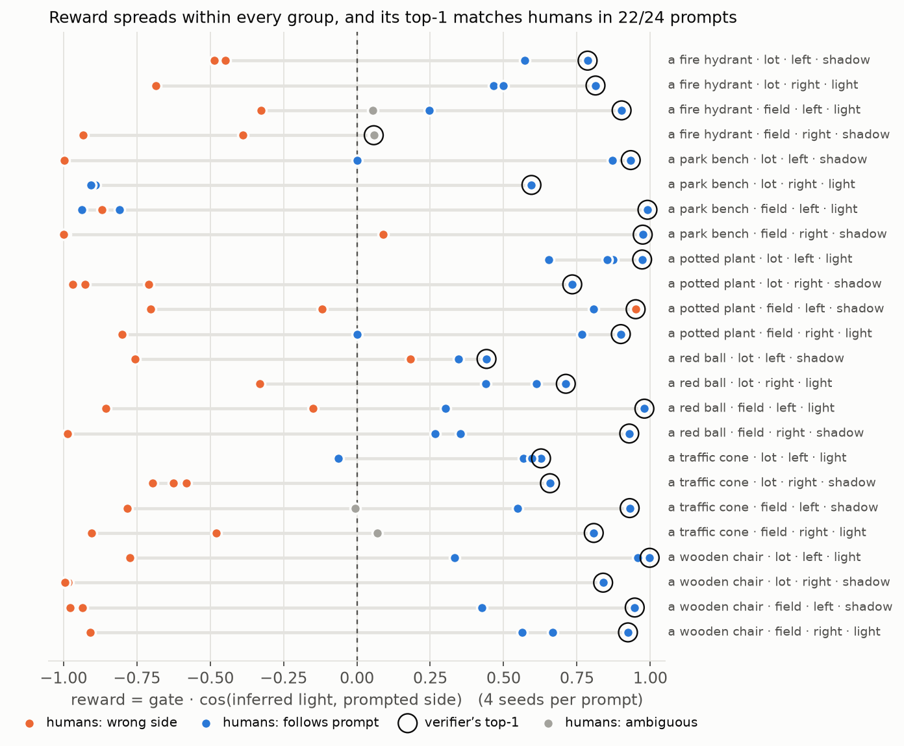
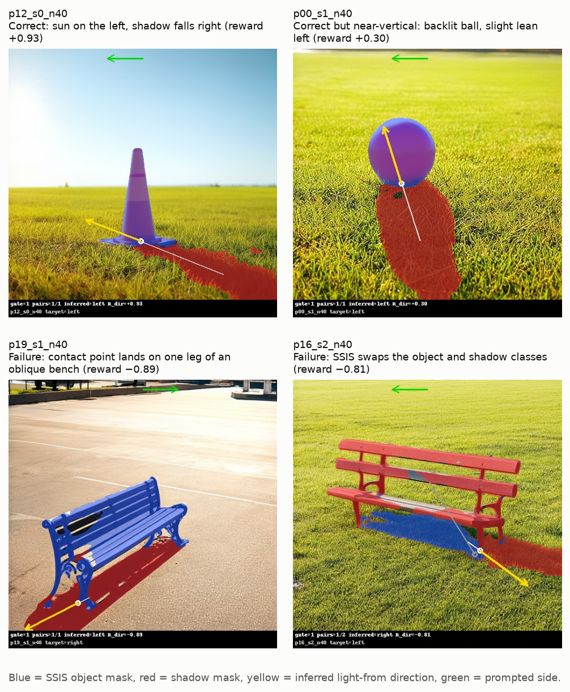

# Smoke tests: RL with Verifiable Lighting for Flow Matching

*2026-11-05. Feasibility checks for project idea 2 (10-623): fine-tune SD3.5-Medium with Flow-GRPO, using a
reward that checks light direction from object–shadow geometry.*

## Recommendation: **GO**, with a cut-down training budget

Every check passed, on a small sample:

- **The verifier agrees with human labels 91% of the time.** That clears the 85% bar on the point estimate, but the
  lower end of the interval is just under it.
- **The base model is at chance** on left/right lighting.
- **The reward separates good samples from bad ones.**
- **One Flow-GRPO training step fits easily in a 32 GB V100's memory.**
- **A cut-down run costs about 25–37 V100 GPU-hours,** inside the ~50 GPU-hour budget. The default Flow-GRPO recipe
  (≈450+ V100-hours for 100 epochs) is not affordable.

Conditions for the full project:
- train with the cut-down config (≈8 prompts × group 8, ≈100 epochs), and batch the training step;
- confirm the 85% bar on a larger, double-labeled set (see Caveats);
- fix or mitigate the two verifier failure modes below before training.

## Results

| Question | Test | Metric | Result (95% CI) | Bar | Verdict |
|---|---|---|---|---|---|
| Does SSIS run on base-model images? | T0, T2 | Runs; classes correct; coverage on all 96 images | yes; **97.9%** (94/96) [92.7–99.4] | | **pass** |
| Is the verifier accurate? | T2 + T3 labels | Direction accuracy on gated images humans labeled L/R | **91.1%** (82/90) [83.4–95.4] | ≥ 85% | **pass** (point estimate) |
| | T2 | Flip consistency (mirror → opposite side, both gated) | **97.8%** (90/92) [92.4–99.4] | ≥ 95% | **pass** |
| Does the base model fail at left/right lighting? | T3 labels | Side accuracy, all 96 images (A/N count as wrong) | **56.2%** (54/96) [46.3–65.7] | chance 50% | **fails** (good for the project) |
| | | … "light from the left/right" phrasing | 70.8% (34/48) [56.8–81.8] | | |
| | | … "its shadow falls to the left/right" phrasing | 41.7% (20/48) [28.8–55.7] | | below chance |
| Is there reward variance within groups? | T5 | Groups (4 seeds) with reward std > 0.05 | **100%** (24/24) [86.2–100]; mean std 0.61 | | **pass** |
| Does the reward pick better samples? | T5 | Best-of-4 by reward vs a random sample, human-judged | **91.7% vs 56.2%**, gap **+35.4 pts** [24.0, 46.9] | gap > 0 | **pass** |
| Does Flow-GRPO fit on a V100-32 in fp16? | T7 probe | Peak memory, 3 epochs, 512 px, group 4, LoRA r=32 | **7.7 GB**; 0 NaN/inf losses, 0 skipped steps | ≤ 31.7 GB | **pass** |
| Can we afford Flow-GRPO? | T6 | Cut-down 8 × 8, 100 epochs | 12 A100-h → **~25–37 V100-h** (rough) | ≤ ~50 | **pass** |



**Figure 1.** Top: how often the image follows the prompted side, judged by humans. A random base-model sample is
at chance; picking the verifier's best of 4 seeds gets 92%. Bottom: verifier accuracy, coverage and flip
consistency against the 85% and 95% bars. Whiskers are 95% Wilson intervals.



**Figure 2.** Reward of each of the 4 seeds per prompt, colored by the human judgment. Within every prompt the
reward spreads widely (useful for GRPO advantages). The verifier's top-1 (circled) is an image humans judged
correct in 22 of 24 prompts.



**Figure 3.** Verifier overlays: two correct cases and the two main failure modes.

## What the numbers say

**Verifier.**
- SSIS finds at least one usable object–shadow pair in 98% of SD3.5-M images; 85 of 96 images have exactly one
  detected pair.
- When the verifier gives a side, it agrees with humans 91% of the time, and it is consistent under mirroring.
- The cosine reward is graded, not binary. Near-vertical shadows get rewards near 0, so the errors there cost
  little as a training signal.

**Base model.**
- SD3.5-M follows the prompted side about as often as a coin flip.
- "Shadow falls …" prompts are below chance, as if the model puts the shadow on the side named in the prompt and
  not the light. RL with this reward targets exactly this gap.
- SD3.5-M also often draws **backlit scenes** (shadow toward the camera). 29% of gated images have an inferred
  light direction within 30° of vertical.

**Training signal.** All 24 prompt groups have spread in reward. Selecting by reward raises human-judged accuracy
from 56% to 92%, so the reward correlates strongly with what people see.

**Compute (T7 probe → T6).**
- The probe ran 3 Flow-GRPO epochs with a random reward. It is a memory and stability test, not a learning test.
- **Setup:** SDE sampling with log-probs, a clipped-ratio policy loss plus KL to the adapter-off reference,
  LoRA r=32 in fp32 on an fp16 base, gradient checkpointing.
- **Peak memory** was 7.7 GB (sampling) and 6.0 GB (training).
- **Measured costs:** sampling 0.66 s/image (10 steps, CFG), training 0.69 s per timestep per image (batch 1),
  reward 0.055 s/image. The training-to-sampling cost ratio is 10.5, so **training dominates**.

| config | images/epoch | s/image (sample + reward + train) | A100 GPU-h (measured) | V100 GPU-h (×2–×3, rough) |
|---|---|---|---|---|
| Flow-GRPO default, 100 epochs (48 × 24) | 1152 | 0.66 + 0.06 + 6.22 = 6.9 | 222 | 444–666 |
| Flow-GRPO default, 1000 epochs | 1152 | 6.9 | 2219 | 4439–6658 |
| **cut-down 8 × 8, 100 epochs** | 64 | 6.9 | **12** | **25–37** |
| cut-down 8 × 8, 300 epochs, half the timesteps | 64 | 0.66 + 0.06 + 3.46 = 4.2 | 22 | 44–67 |
| cut-down 16 × 8, 200 epochs | 128 | 6.9 | 49 | 99–148 |

Training uses about 6 GB of the 32 GB, so batching 4–8 samples per training step should cut the dominant cost;
this is not yet measured. The V100 column scales the A100 timings by 2–3× (V100 fp16 tensor throughput is about
2.5× lower and it has no FlashAttention). A real V100 run of the probe would replace it.

## Failure modes (8 verifier errors out of 90)

1. **Near-vertical shadows** (3 of 8; inferred angle 86°, 101°, −85°). The shadow falls toward or away from the
   camera, so left/right is decided by a small horizontal component. *Mitigation:* the cosine already keeps these
   rewards near 0; optionally gate out |cos| < 0.3.
2. **Contact point on wide or oblique objects** (park benches; Figure 3, bottom left). The bottom 10% of the
   bounding box is one leg, so the vector from that corner to the shadow centroid points the wrong way.
   *Mitigation:* use the centroid of all ground-contact pixels, or the object's mask centroid projected to the
   ground line.
3. **Object/shadow class swap by SSIS** (Figure 3, bottom right): the red bench was labeled shadow and its shadow
   labeled object. *Mitigation:* check that the "shadow" is darker than its surroundings and the "object" is not.
   T0 showed this luminance check is unreliable for dark objects, so use it only to veto clear swaps.

5 of the 8 errors are on park benches (wide, oblique objects); the other 3 are one each on the red ball and
the traffic cone (both near-vertical) and the potted plant.
**Reward hacking risk:** the policy could learn to draw one long, clean, horizontal shadow, which is exactly what
the verifier rewards. Watch image quality (or add a preference term) during training.

## Caveats

- **Small sample:** 24 prompts × 4 seeds = 96 images. The verifier-accuracy interval [83.4, 95.4] still includes
  values below 85%. Doubling or tripling the labeled set would settle it.
- **Single labels:** one label per image, so there is no agreement check (kappa).
  - The three label files have back-to-back timestamps at about 1.5–2 s per image. If one person labeled all
    three, these are single-rater labels.
  - Only 4 images were labeled ambiguous and none "no shadow", even though about 29% are near-vertical. Some
    ambiguous cases may have been forced to L/R, which can inflate both base-model and verifier numbers.
  - *Next check:* a second rater on the ~30 near-vertical images.
- **False gate rate untested:** no image was labeled "no shadow".
- **Not V100 numbers:** generation and SSIS timings come from an L40S and an A10; the probe ran on an A100 with a
  memory cap. The memory result transfers; V100 speed is estimated.
- **Different SSIS environment:** Modal runs SSIS on Python 3.11 / torch 2.0.1 instead of the planned
  Python 3.9 / torch 1.13.1 (Modal dropped 3.9). Same checkpoint and SSIS commit; T0 confirmed the classes and
  directions on the SSIS demo photos.

## What was run, and what was not

The plan was reduced to get first results within about an hour (`env/fast_mode.json`):

- **T0:** SSIS demo images + mirrors, class check, overlays.
- **T1:** 24 prompts (6 objects × 2 scenes × left/right, phrasing balanced) × seeds 0–3 at 40 steps.
  512 px, CFG 4.5, fp16. 96 images, none black.
- **T2:** SSIS + verifier + flip test on the 96 images and their mirrors.
- **T3:** static labeling pages (L/R/A/N, prompt hidden), 32 images per annotator, no shared set.
- **T4/T5 (reduced):** the metrics above (`analysis/fast_metrics.py`).
- **T6:** from measured probe timings (`analysis/t6_from_probe.py`).
- **T7:** memory and stability probe only.

**Not run** (deprioritized):
- the 10-vs-40-step comparison;
- inter-annotator kappa;
- the gate-cutoff sweep (the code exists: `analysis/gate_sweep.py`);
- the ~100-step Flow-GRPO run with the real reward;
- T8, the VLM judge.

**PSC:**
- No PSC job produced results; the queue never reached them. The duplicate PSC jobs were cancelled.
- The T7 probe job is still queued on V100-32 (50271966) and would give real V100 timings if it runs.
- Debugging on Modal found two install bugs in the PSC SSIS setup (pysobatools, SSIS dependencies); both are
  fixed in `env/setup_ssis.sh`.

## Verifier definition

For each SSIS object–shadow pair:
- **contact point** c = mean of the object-mask pixels in the bottom 10% of the object's bounding box;
- **shadow vector** v = shadow centroid − c; the light comes from −v;
- **pair confidence** = min(object score, shadow score).

A pair is **valid** if:
- its confidence is ≥ 0.3;
- the shadow covers ≥ 0.1% of the image;
- |v| ≥ 2% of the image width.

Combining pairs and scoring:
- valid pairs are combined by a confidence-weighted mean of unit vectors;
- **gate** = 1 if any pair is valid;
- **R_dir** = cos(inferred light direction, prompted side);
- **reward** = gate · R_dir.

R_cons is computed when there are ≥ 2 pairs (logged, not used). Every pair's vector, scores, areas and invalid
reasons are saved, so the cutoffs can be re-tuned without re-running SSIS. Code: `verifier/direction.py`
(unit tests in `verifier/test_direction.py`).

## Reproducing

Exact versions, pinned commits, build fixes and all commands are in [`env/README.md`](env/README.md). In short:

```bash
cd smoke/env && modal run --detach modal_app.py --skip-t7 && modal run --detach modal_app.py --step t7
modal volume get rl-lighting-smoke results ../results_modal
cd .. && python analysis/fast_metrics.py --scores results_modal/T2_scores_40steps.jsonl --label-dir label --out results_modal/fast
python analysis/t6_from_probe.py --probe results_modal/T7/probe_512/probe.json --ssis results_modal/T2/raw_40steps/ssis_stats.json --out results_modal/T6
python analysis/make_figures.py --results results_modal --label-dir label --out results_modal/figures
```

**Artifacts:**
- `results_modal/fast/` — metrics JSON and table
- `results_modal/T2/overlays_40steps/` — one overlay per image
- `results_modal/contact_sheets_40steps/`
- `results_modal/T7/probe_512/probe.json`
- `results_modal/T6/`
- `results_modal/figures/`
- labels: `label/labels_{A,B,C}.csv`; image key: `label/key.csv`
